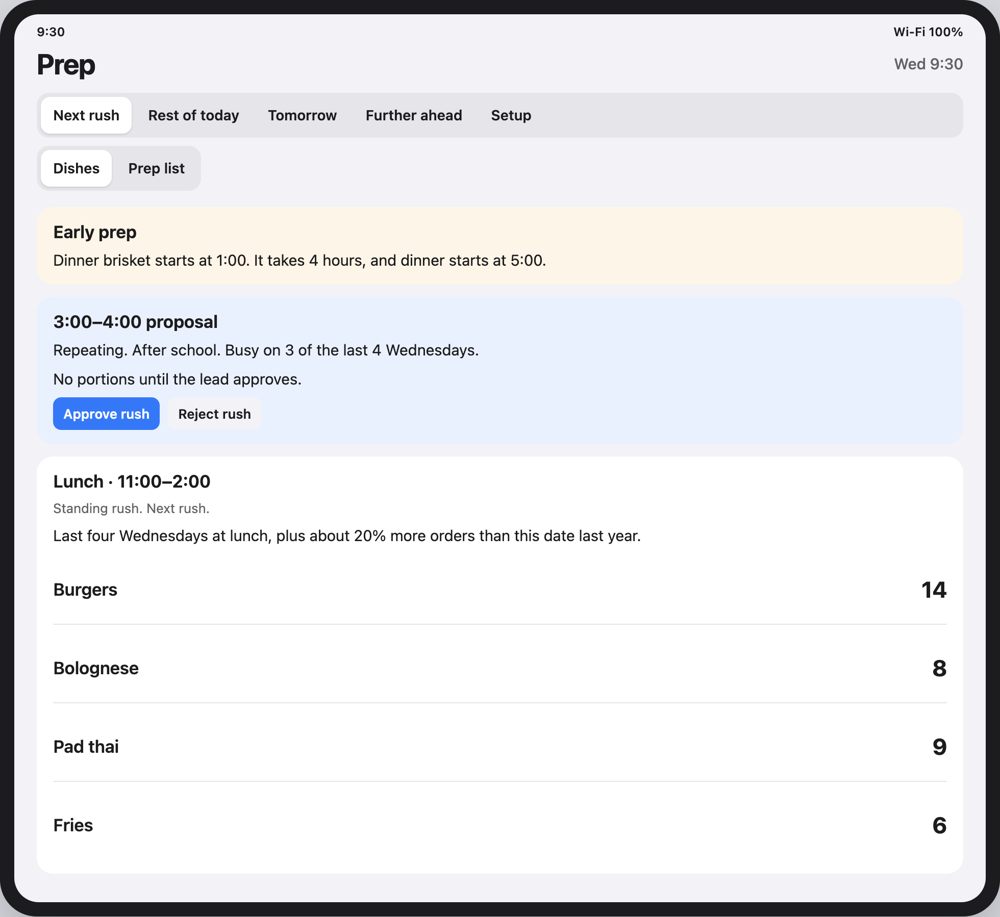
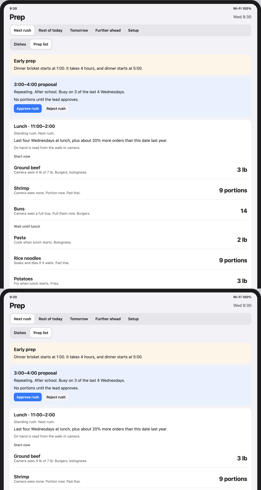
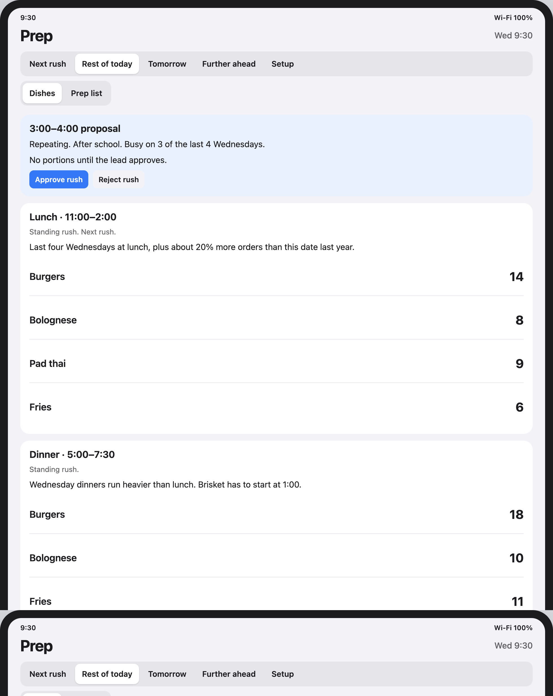
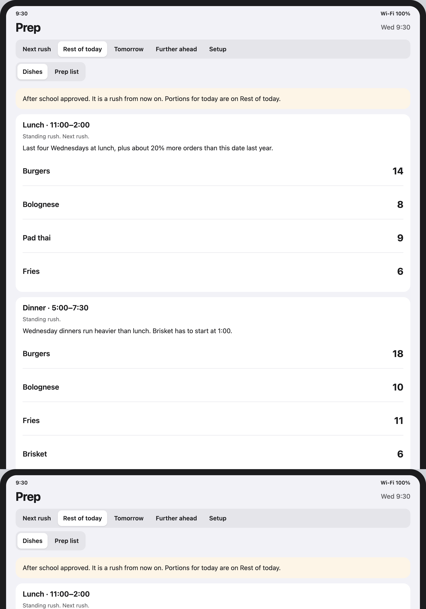
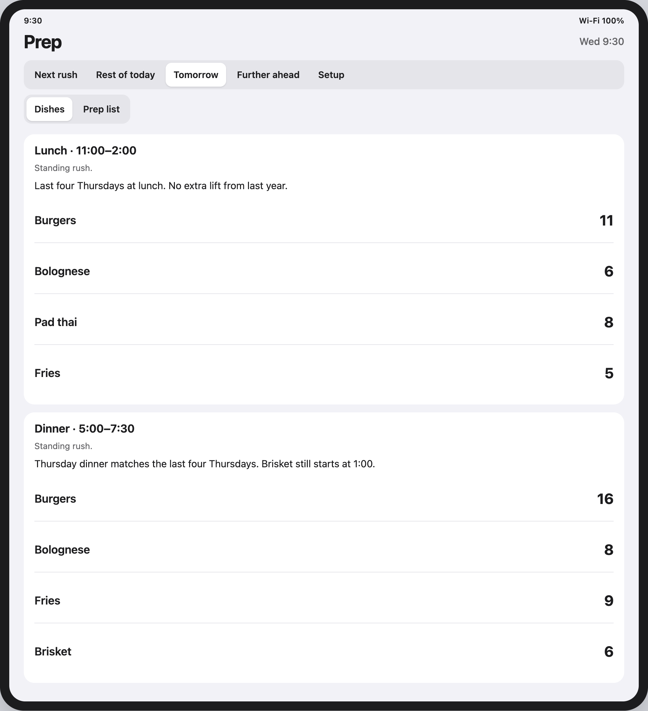
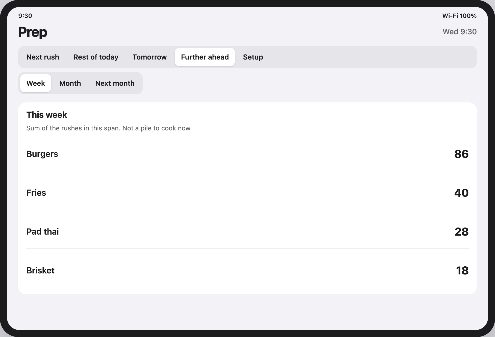
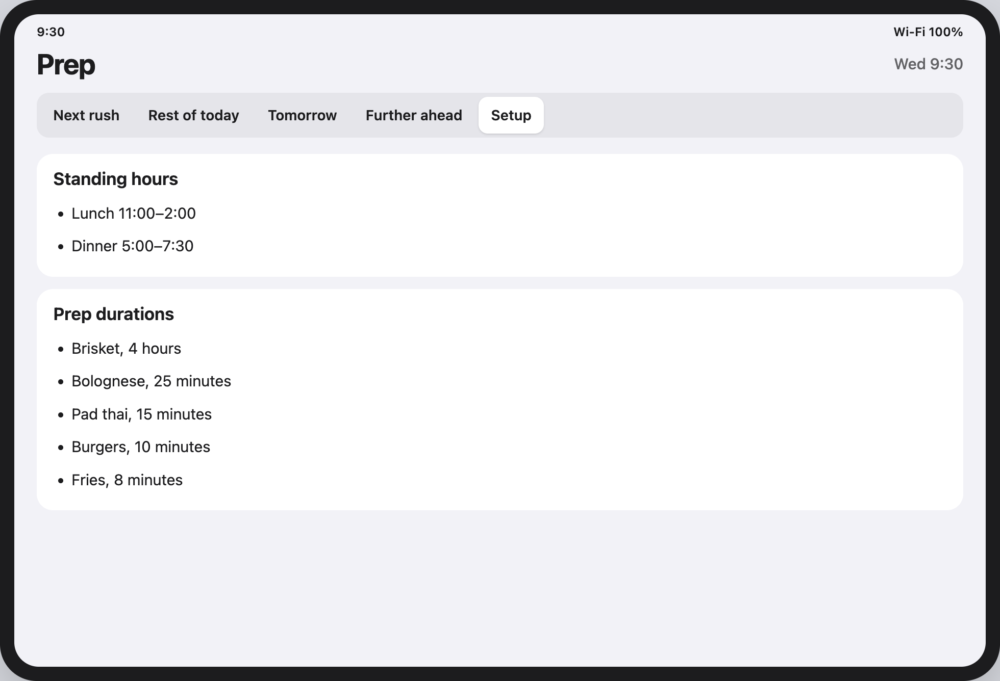
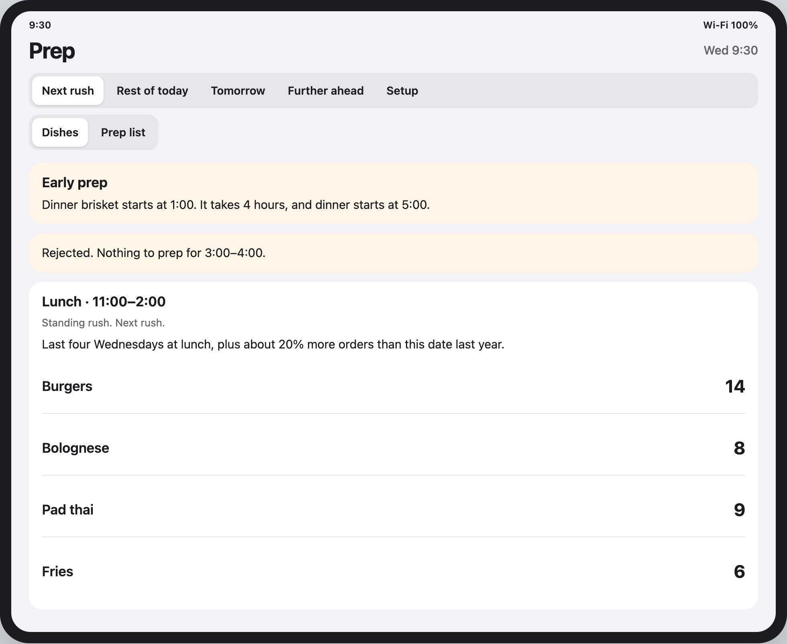
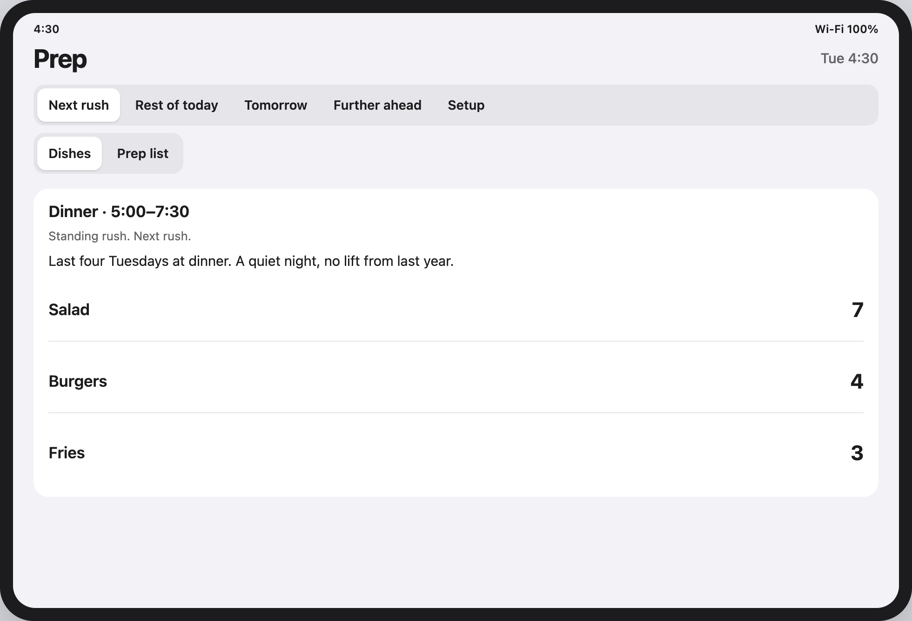
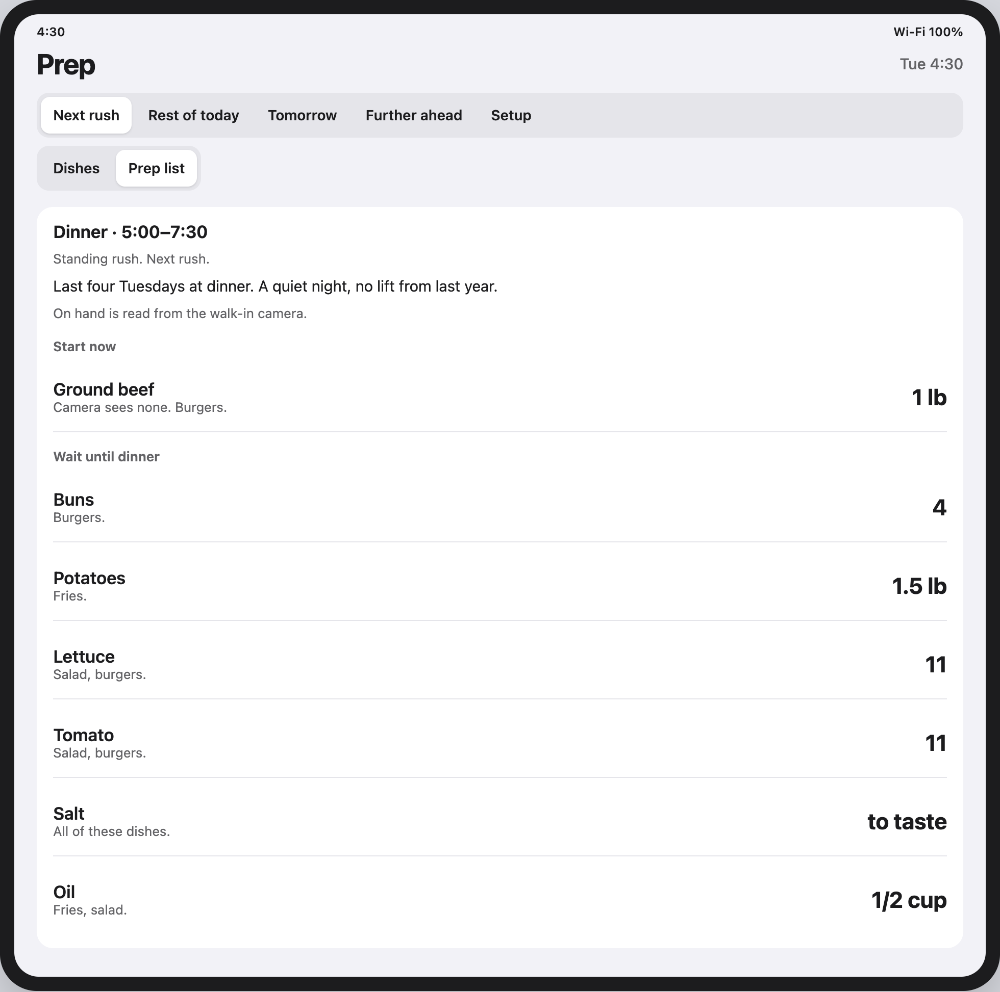

# Presentation prep

Five-minute DoorDash talk for the prep tablet. Screenshots are the wireframe, with synthetic Wednesday and Tuesday data. The Vite app at `frontend/` is the same screen with empty placeholders until recommendations are connected.

Open the live wireframe at `wireframes/prep.html`. The menu above the tablet switches **Wednesday lunch** and **Quiet Tuesday**.

## What DoorDash asked to see

- A demo with a happy path and a sad path. Live is preferred. Mocks are allowed.
- A deck that names the problem and the solution.
- Useful extras: who uses it, trade-offs, benefits, and technical limits.
- Other pain points are allowed. Covering more than one is encouraged.

Event time is about five minutes, then one to two minutes of questions.

## Pain points

| DoorDash pain point | What this does |
| --- | --- |
| Order management and preparation timing | Main problem. The shift lead sees dish counts for the next rush, the rest of today, and tomorrow, plus a note when a later rush has to start early. |
| Inventory management and forecasting | Partial. History becomes a prep guideline, shared ingredients roll up, and on-hand amounts are meant to come from the walk-in camera. It does not buy food, track spoilage, or replace a full inventory system. |
| Order packing and pickup | Not this product. |
| Bookkeeping and financial health | Not this product. |
| Staffing and skill mix | Not this product. |

The supporting job is one order history. DoorDash, Grubhub, and in-house orders become one record the guideline can read. That history is not a sixth pain point. It is how the timing and forecast numbers get made.

## How it is solved

The shift lead opens this between rushes, as an applet in the system they already use. It is not a firing board during service. Everyone sees the same read-only counts. There is no login, no checkoff, and no editing of the numbers.

Advice is a count of dishes to have ready. A burger, a cheeseburger, and a no-onion burger are one dish. The kitchen does not get a shopping list in pounds as the main row.

Windows stay separate. Lunch burgers are not added to dinner burgers. **Further ahead** is a sum of those rushes for the week, month, or next month, labeled so nobody treats it as a pile to cook now.

A rush that must start before it is next shows an early-prep note. Prep duration is set by the restaurant. In the Wednesday mock, brisket takes 4 hours and dinner starts at 5:00, so the note says to start at 1:00.

The guideline looks at the last four ordinary same weekdays during that rush’s hours. Holidays are skipped. If the same date last year exists, the count scales by that order-volume change. Missing history is not filled in. The reason sits on the rush, once, not on every dish.

Standing lunch and dinner hours are set by the restaurant and do not ask for approval every day. A repeating off-hours rush is proposed only after it was busy on at least 3 of the last 4 same weekdays, and only the lead can approve it. Approval makes it a rush from then on. A one-time spike, if approved, is prep for that occurrence only. Reject means nothing to prep for that window.

**Prep list** is a toggle on the same dishes. It lists every ingredient, proteins and carbs first and seasonings last. Ingredients that will not hold wait until that rush. Shared ingredients roll up: burgers and bolognese both draw ground beef. On hand is read from the walk-in camera. The wireframe shows that read. A live camera is not connected.

## What is actually built

- `wireframes/prep.html` and `wireframes/mock-data.js`: the tablet with the two scenarios below. Use this for the demo.
- `frontend/`: the same tablet as an app. Counts are dashes until recommendations data arrives.
- Sales backend: stores imported orders and can list them. It does not forecast, plan ingredients, or feed this screen yet.

Say that limit out loud. The judgment rules above are the product. The model that applies them is still being built.

## Suggested five minutes

| Time | Slide or screen | Say this |
| --- | --- | --- |
| 0:00–0:40 | Problem | During a rush, orders arrive from several apps and the kitchen guesses what to start. Food waits, or the rush starts with nothing ready. Packing, books, and staffing are real problems. This talk is the guess before the rush. |
| 0:40–1:10 | Who | The shift lead checks one tablet between rushes. Cooks can look at the same list. Nobody edits the counts. |
| 1:10–2:40 | Happy path | Wednesday at 9:30. Walk Next rush, then Prep list, then approve After school and show Rest of today. |
| 2:40–3:20 | Sad path | Reject the 3:00 rush, or switch to Quiet Tuesday. Small counts, no new rush, no early prep. |
| 3:20–4:10 | How the number is made | Last four ordinary same weekdays, skip holidays, scale by last year when that date exists, restaurant sets hours and durations, lead approves anything that is not already standing. |
| 4:10–4:40 | Trade-off | Toast’s catering prep list is exact because the orders are already booked. This screen is the forecast before those orders exist. It is weaker once the food is sold. |
| 4:40–5:00 | What is real | Wireframe is the scenario. The app shell is up. Recommendations and the camera are the next connection. We are not claiming a live kitchen deploy. |

## Happy path: Wednesday lunch, 9:30

Standing lunch is 11:00–2:00. Dinner is 5:00–7:30. Brisket has to start at 1:00. An after-school window, 3:00–4:00, was busy on 3 of the last 4 Wednesdays, so it is waiting on the lead.

### Next rush, dishes

Early prep is visible before the lead does anything. The 3:00 proposal has no portions yet. Lunch is the next standing rush: 14 burgers, 8 bolognese, 9 pad thai, 6 fries. The reason is the last four Wednesdays at lunch, plus about 20% more orders than this date last year.

### Next rush, prep list

Same lunch, as ingredients. Start now: ground beef, shrimp, buns. The camera line is the on-hand read, for example 4 lb of 7 lb of ground beef, shared by burgers and bolognese. Wait until lunch: pasta, noodles, potatoes, and the seasonings, because they will not hold.

### Rest of today, before approval

Lunch and dinner stay in two blocks. Dinner is 18 burgers, 10 bolognese, 11 fries, 6 brisket. The after-school rush is not in the list yet.

### Rest of today, after approval

Approve. The note says it is a rush from now on, and today’s portions appear as After school: 10 burgers and 8 fries. Lunch and dinner are unchanged.

### Tomorrow

Thursday lunch and Thursday dinner, still separate. Thursday lunch has no extra lift from last year. Brisket still starts at 1:00.

### Further ahead

Week, month, and next month are sums. This week is 86 burgers, 40 fries, 28 pad thai, 18 brisket. The line on the card says it is not a pile to cook now.

### Setup

The restaurant’s standing hours and prep durations. Brisket is 4 hours, which is why 9:30 already knows about 1:00.

## Sad path

Show one of these. Both are in the wireframe.

### Reject the new rush

Reject 3:00–4:00. The note says nothing to prep for that window. Lunch is still 14 burgers. Standing rushes do not disappear because a proposal was rejected.

### Quiet Tuesday, 4:30

No proposal and no early-prep note. Next rush is dinner: 7 salads, 4 burgers, 3 fries. The reason says it is a quiet night and last year adds nothing. The prep list is short. Ground beef still starts now because the camera sees none. Lettuce can wait.

## Trade-offs to say if asked

- Dishes stay the main row. The ingredient list is useful when recipes are current. A stale recipe is worse than no ingredient list.
- The camera is how the kitchen knows what it already has. The wireframe shows that sentence and a few reads. There is no camera feed in the demo.
- Counts are a guideline. They do not drop as the kitchen cooks, and nobody checks them off.
- One-time approval does not create next week’s rush. Repeating approval does.
- Packing, payouts, and the schedule are untouched on purpose.

## Questions we should be ready for

- Where do the orders come from? Stored marketplace and in-house history, not a live guess. The sales API can list orders. It does not compute these counts yet.
- What if last year is missing? Use the last four ordinary weekdays and do not invent a growth rate.
- What if the lead disagrees? They can reject a new rush. They cannot rewrite a count on the tablet.
- Why not Toast’s prep list? Toast lists items already sold. This list is for the rush that has not started.
